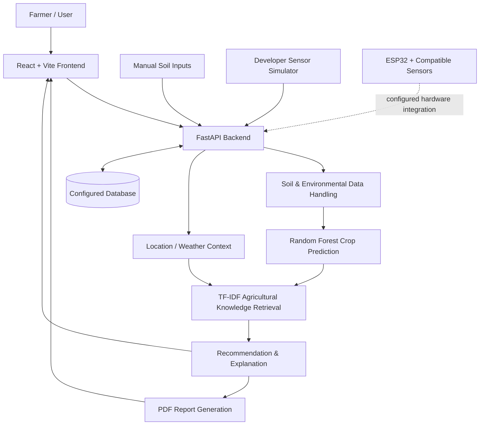

<div align="center">


### 🌱 From Soil Testing to Smarter Crop Decisions

**An AI + IoT smart-agriculture project for soil analysis and crop recommendation.**

[](https://www.python.org/)
[](https://react.dev/)
[](https://fastapi.tiangolo.com/)
[](https://scikit-learn.org/)
[](https://www.espressif.com/en/products/socs/esp32)

[Features](#-key-features) · [Screenshots](#-application-screenshots) · [Architecture](#-system-architecture) · [Tech Stack](#-technology-stack) · [Run Locally](#-run-locally) · [Workflow](#-typical-user-workflow) · [Limitations](#-notes-and-limitations)

</div>

---

## 🌾 Overview

KrushiAI Module 1 is an AI- and IoT-oriented soil testing and crop recommendation application. It brings soil nutrient readings, environmental inputs, location/weather context, machine-learning predictions, and downloadable reports into one workflow.

Users can enter soil measurements manually or explore the workflow with the developer sensor simulator. The repository also includes an ESP32 integration area for compatible sensor hardware.

> **Project scope:** This README describes the capabilities documented in the repository. Actual sensor readings require compatible, configured hardware; the simulator is intended for development and demonstration.

## ✨ Key Features

| Feature | Description |
|---|---|
| 🧪 Soil testing | Record Nitrogen (N), Phosphorus (P), Potassium (K), soil moisture, temperature, and humidity. |
| ✍️ Manual input | Enter known soil and environmental values through the application. |
| 📡 Sensor workflow | Includes ESP32-oriented integration for compatible soil and environmental sensors. |
| 🧑‍🔬 Development simulation | Explore the workflow without connecting physical sensors. |
| 🌱 Crop recommendation | Uses a Random Forest model to generate crop predictions from the supported inputs. |
| 🌦️ Location and weather context | Supports location-aware analysis and weather data retrieval, subject to configuration and availability. |
| 📚 Agricultural knowledge retrieval | Uses TF-IDF-based retrieval to support agricultural explanations. |
| 📄 PDF reports | Generate downloadable soil analysis and crop recommendation reports. |
| 👨‍🌾 Farmer and test records | Maintain farmer profiles and soil-test history in the configured database. |

## 🖼️ Application Screenshots

Add your real application screenshots to `docs/screenshots/` using the filenames below, or change the paths to match your own filenames. These image files are **not included automatically** by this README.

<table>
  <tr>
    <td width="50%" align="center">
      <strong>1. Main application / dashboard</strong><br/><br/>
      
" alt="KrushiAI dashboard screenshot — add screenshot file" width="100%"/><br/>
      <sub>Suggested capture: application landing page or dashboard.</sub>
    </td>
    <td width="50%" align="center">
      <strong>2. Soil testing form</strong><br/><br/>
      
" alt="KrushiAI soil testing screenshot — add screenshot file" width="100%"/><br/>
      <sub>Suggested capture: NPK, moisture, temperature, and humidity inputs.</sub>
    </td>
  </tr>
  <tr>
    <td width="50%" align="center">
      <strong>3. Crop recommendation</strong><br/><br/>
      
" alt="KrushiAI crop recommendation screenshot — add screenshot file" width="100%"/><br/>
      <sub>Suggested capture: a real result from the running application.</sub>
    </td>
    <td width="50%" align="center">
      <strong>4. Soil report</strong><br/><br/>
      
" alt="KrushiAI soil report screenshot — add screenshot file" width="100%"/><br/>
      <sub>Suggested capture: report preview or PDF page with dummy/test data.</sub>
    </td>
  </tr>
</table>

If a screenshot is not ready yet, remove its `` element until you add the image. Use only screenshots captured from the actual application; avoid publishing personal farmer information, phone numbers, API keys, or other secrets.

## 🏗️ System Architecture



**Request flow:** the user supplies soil values manually or through the available simulation/hardware path; the frontend communicates with the FastAPI backend; the backend coordinates prediction, supporting context, database records, and report generation; results are returned to the UI.

The diagram is a high-level conceptual view of the documented system, not a claim that every optional integration is connected in every environment.

## 🧰 Technology Stack

| Layer | Technologies documented in the repository |
|---|---|
| Frontend | React, Vite, Tailwind CSS, Axios, Recharts |
| Backend API | Python, FastAPI, SQLAlchemy, Pydantic |
| Machine learning | scikit-learn, Random Forest |
| Knowledge retrieval | TF-IDF |
| Database | SQLite by default; MySQL supported through configuration |
| Reports | ReportLab PDF generation |
| IoT / sensors | ESP32 integration area; compatible NPK, environmental and moisture sensors as configured |
| Development tools | Git, Node.js, npm, Python, PowerShell |

## 🚀 Run Locally

### Prerequisites

- Git
- Python 3.11 (recommended by the project documentation)
- Node.js and npm
- PowerShell on Windows for the supplied `.ps1` scripts

### 1. Clone the repository

```bash
git clone https://github.com/Sakshi-Zurale/Module1_AI-IoT-based-soil-testing-and-intelligent-crop-recommendation-system.git
cd Module1_AI-IoT-based-soil-testing-and-intelligent-crop-recommendation-system
```

### 2. Configure environment

Review the root `.env.example` and copy the settings you need into your local environment configuration. Check the frontend's own configuration and example file, if present, before starting the UI. Use your own valid local values for any optional integrations.

**Never commit `.env` files containing real secrets, API keys, passwords, or private farmer information.**

### 3. Start the backend

**Recommended on Windows:** from the repository root, run:

```powershell
.\run_backend.ps1
```

The repository script creates a backend virtual environment if needed, installs `backend/requirements.txt`, trains the crop model if the expected model file is missing, runs `pytest`, and starts Uvicorn. If tests fail, resolve the reported issue before relying on the application.

**Manual alternative:**

```powershell
cd backend
python -m venv .venv
.\.venv\Scripts\Activate.ps1
pip install -r requirements.txt
python -m app.ml.train
uvicorn app.main:app --reload
```

The documented API address is `http://localhost:8000`; interactive API documentation is at `http://localhost:8000/docs`.

### 4. Start the frontend

Open a **second terminal** at the repository root and run:

```powershell
.\run_frontend.ps1
```

The script enters `frontend/`, installs npm dependencies if `node_modules` is missing, and runs the Vite development server.

**Manual alternative:**

```powershell
cd frontend
npm install
npm run dev
```

Open the local URL printed by Vite in the terminal. The repository documentation lists `http://localhost:5173` as the expected development address.

### 5. Try the workflow

1. Open the frontend and create/select a farmer profile as supported by the application.
2. Enter soil values manually or use the developer sensor simulator.
3. Submit the soil test for analysis.
4. Provide or confirm location details if using location/weather-aware functionality.
5. Review the crop recommendation and supporting explanation.
6. Download the soil-testing / recommendation report.
7. Review saved soil-test history if available in the configured database.

> **Hardware note:** You can explore the software flow without physical sensors using manual input or the simulator. Physical ESP32/sensor use requires compatible wiring, firmware, serial/network configuration, and backend integration settings for your setup.

## 📁 Repository Structure

```text
.
├── backend/       # FastAPI backend, ML pipeline, data access and reports
├── frontend/      # React + Vite user interface
├── iot/esp32/     # ESP32 / sensor integration files
├── docs/          # Project documentation and (recommended) screenshots
├── .env.example   # Example environment configuration
├── run_backend.ps1
├── run_frontend.ps1
└── README.md
```

## 🧪 Model & Data Notes

- The project documents a Random Forest crop prediction model.
- The backend startup script trains the model if `backend/app/ml/models/crop_model.joblib` is missing.
- Model recommendations depend on the features, training data, and preprocessing used by the implementation.
- For credible evaluation, document the dataset source, train/test methodology, metrics, and limitations after verifying them against the actual training pipeline. Do not treat a sample prediction as proof of real-world accuracy.

## ⚠️ Notes & Limitations

- Crop recommendations are decision-support suggestions, not a substitute for advice from qualified local agricultural experts.
- Validate predictions with reliable, region-specific agricultural data before real-world use.
- Sensor readings depend on sensor compatibility, calibration, wiring, and integration configuration.
- Weather and location features may require configuration and network access.
- Use dummy or consented data in screenshots and demos. Do not publish real farmer records or credentials.

## 🔭 Future Improvements

Potential next steps, depending on project priorities:

- Add verified English and Marathi report examples.
- Document model evaluation with reproducible metrics and dataset provenance.
- Add real sensor demonstration screenshots and hardware setup instructions.
- Expand automated tests for API routes, model input validation, and report generation.
- Improve farmer-facing explanations and accessibility.

## 👩‍💻 Project

Developed as part of the **KrushiAI** smart-agriculture initiative — connecting soil data, machine learning, and farmer-oriented decision support.

<div align="center">


**KrushiAI — Growing Intelligence for Agriculture 🌱**

</div>
